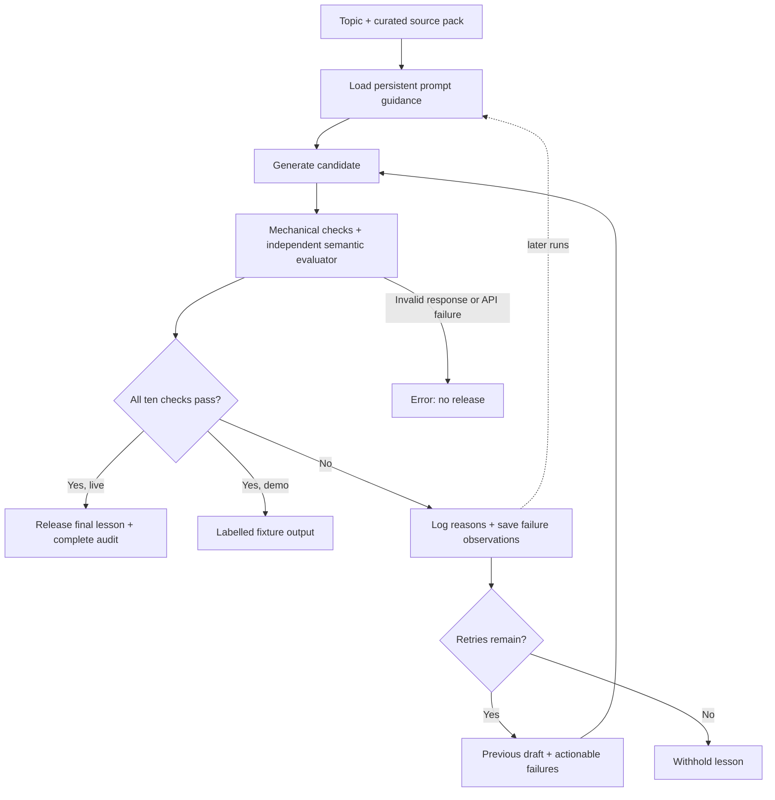

# Lesson Forge

A self-evaluating lesson generator for a class-12 graduate from India with limited English and no computing background.

**Input:** a topic and curated source pack. **Output:** a lesson only when all ten checkpoints pass, plus every rejected draft, reason, and actual revision diff. The controller allows at most two regenerations.

**Current verification:** offline control-flow tests and a scripted error-repair rehearsal pass. A live API run and live evaluator calibration have **not** been performed. The included lesson is an authored reference fixture, not a claimed live-generated result. See [submission status](docs/SUBMISSION.md).

## Run in one minute

Requires Python 3.10+. There are no third-party runtime dependencies. Run commands from this repository's root; installation is unnecessary.

```bash
python3 -m unittest discover -s tests -v
python3 -m lesson_forge run --mode demo --inject-error first
```

Open `report.html` in the printed run directory. Attempt one contains the deliberately false claim **“RAG guarantees that every answer is correct.”** The scripted rehearsal rejects it, and the second fixture removes it. Read `rejection_log.json` for checkpoint evidence and a unified diff.

**Demo is a fixture replay.** It proves the controller, logging, feedback wiring and memory behavior; it does not prove semantic judging or model generation. Its output is named `demo_lesson.md`, its status is `DEMO_PASSED`, and it cannot create `final_lesson.md`.

## Live generation

Choose a provider exposing an OpenAI-compatible HTTPS Chat Completions endpoint and models supporting JSON object output and `max_completion_tokens`. The adapter uses the [official Chat Completions request format](https://developers.openai.com/api/reference/resources/chat/subresources/completions/methods/create). Other providers may need adapter changes; compatibility is not assumed universally.

Set these environment variables in the terminal where you run the app:

```bash
export LLM_BASE_URL="https://api.openai.com/v1"
export GENERATOR_MODEL="your-supported-generator-model"
export EVALUATOR_MODEL="your-supported-evaluator-model"
# Set LLM_API_KEY through your shell's secure input or secret manager.
# Never commit it. .env.example lists the variable names; .env is not auto-loaded.

python3 -m lesson_forge run --mode live --topic "Introduction to RAG"
python3 -m lesson_forge run --mode live --inject-error first
```

The first command creates the submission lesson if it passes. The second demonstrates the *real* evaluator catching an injected error without being told that an error was injected. Inspect the actual verdict; if the evaluator misses it, that is a failed evaluation experiment, not a successful demo. Generator and evaluator use independent requests. Prefer a stronger/different evaluator model when available; separate calls to the same model still share blind spots.

No API key is read from source code. No automatic fallback to demo occurs. Live errors return a nonzero exit code.

## Quality gate

| Check | Hard pass requirement | Method |
|---|---|---|
| Structure | All nine required headings, exactly once and in order | Code |
| Readability | 450–1000 prose words; mean sentence/line <=18 words; longest <=32 | Code |
| Citations | >=2 body source IDs; IDs and URLs allowlisted; cited source URLs present | Code |
| Accuracy | Every technical claim supported; no contradiction or false guarantee | Independent LLM |
| Foundations | Topic and prerequisites explained from zero | Independent LLM |
| Coverage | What, why, correct mechanism, and limitations all present | Independent LLM |
| Example | Fictional Indian college example with exact evidence, supported answer, and missing-answer case | Independent LLM |
| Language | Everyday English; every technical term explained at first use | Independent LLM |
| Flow | Prerequisites → mechanism → example → limits → practice; no contradictory advice | Independent LLM |
| Practice | Two understanding questions with correct explained answers | Independent LLM |

The full rubric is executable in `lesson_forge/rubric.py`. There is no weighted average. **One fail means rejection.** Missing checks, duplicate IDs, string booleans, fabricated quotes, or malformed JSON mean an evaluator error and no release. A citation-format pass alone does not establish grounding: the semantic accuracy check must also pass.



## Persistent memory and self-evolution

SQLite stores failure categories and human feedback across processes. After the **same checkpoint fails in two distinct runs**, a curated instruction is activated in later generator prompts and evaluator focus guidance. Retrying three times within one run counts only once. The policy is frozen at run start and recorded in the manifest; the next run loads the updated policy.

Learning is scoped by canonical topic, source hash, rubric, live/demo mode, and synthetic-error versus ordinary runs. This prevents a demonstration or unrelated topic from altering normal live guidance. Raw model suggestions and human notes are stored for audit but never promoted into system instructions. The rubric itself remains fixed: lowering standards would teach the system to game acceptance.

Rehearse memory evolution with a separate database:

```bash
python3 -m lesson_forge run --mode demo --inject-error first --memory data/rehearsal.sqlite3
python3 -m lesson_forge run --mode demo --inject-error first --memory data/rehearsal.sqlite3
python3 -m lesson_forge run --mode demo --inject-error first --memory data/rehearsal.sqlite3
```

The third run's manifest contains an activated `accuracy` hint. This demonstrates adaptation, not a measured improvement in model quality. To record human feedback:

```bash
python3 -m lesson_forge feedback --run runs/YOUR_RUN_ID --criterion language --note "Several words were too difficult for the intended learner."
```

Use the same `--memory` path if the original run used a custom database. Human feedback does not overwrite a past verdict. Repeated feedback on one run counts only once.

## Evaluate the evaluator

```bash
python3 -m lesson_forge.calibrate
```

This makes seven **live evaluator calls**, with no generation, release, or memory writes. It tests a reference lesson and six controlled mutations: a false guarantee, false retraining claim, wrong example time, unexplained jargon, missing practice, and an embedded instruction to pass incorrect content. Each negative probe must fail the targeted criterion; rejecting it for an unrelated formatting issue is insufficient. The reference must pass every check.

Results are saved under `runs/calibration-*`. These are smoke tests, not statistical estimates of precision/recall. Production calibration should use a larger held-out set labelled by teachers and target learners. Prompt hardening reduces but does not eliminate prompt-injection risk.

## Artifacts and exit codes

Each run creates a new directory; previous runs are never overwritten.

| Artifact | Purpose |
|---|---|
| `manifest.json` | Status, models, timestamps, hashes, policy snapshots, API usage |
| `source_pack.json`, `rubric.json`, `prompts.json` | Inputs for reproduction |
| `attempt-N.md` | Exact candidate seen by evaluator, including any injected fault |
| `attempt-N-*-input/output.json` | Exact role payloads and parsed model outputs |
| `rejection_log.json` | All attempts, boolean checks, reasons, quotes, fixes, actual diffs |
| `report.html` | Readable audit; generated text is HTML-escaped |
| `final_lesson.md` | Present only after a successful live gate |
| `demo_lesson.md` | Present only after a successful fixture rehearsal |

Exit `0`: live release or explicitly labelled demo success. Exit `2`: retries exhausted, lesson withheld. Exit `1`: input, provider or evaluation error. A provider refusal, incomplete output, or invalid evaluator response stops the run; content regeneration is reserved for valid rubric failures.

Maximum cost per generation run: three candidates × two role calls = six logical model calls. Each call allows one retry for network errors, rate limits, or server errors, with a 60-second socket timeout and 6,000 completion-token limit. Up to 12 HTTP attempts are possible. The timeout is a socket/network limit, not a strict end-to-end deadline. Returned usage is recorded; pricing depends on configured models and is not estimated here.

`data/` and `runs/` are ignored by Git because prompts and logs may include user content. Sanitized offline evidence is included in `examples/demo-run/`.

## Other topics

```bash
python3 -m lesson_forge run --topic "Your topic" --sources sources/your-topic.json
```

Use the same JSON source-pack shape as `sources/rag.json`, with two or more reviewed sources and aliases. The topic must match that pack. General lesson checks apply; RAG-specific clauses apply only to RAG. The college-example rubric fits this assessment but may need a versioned adjustment for some other subjects. Offline replay and deliberate-error injection support the bundled RAG topic only.

## Design and submission

- [Exact next steps: setup, live runs, document and recording](docs/NEXT_STEPS.md)
- [Architecture and decisions](docs/ARCHITECTURE.md)
- [18-minute Loom walkthrough](docs/LOOM_SCRIPT.md)
- [Submission status and remaining steps](docs/SUBMISSION.md)
- [Reference lesson](examples/reference_lesson.md)

The lesson facts are grounded in [AWS's RAG explanation](https://aws.amazon.com/what-is/retrieval-augmented-generation/), the [original RAG research paper](https://arxiv.org/abs/2005.11401), and [Microsoft's RAG overview](https://learn.microsoft.com/en-us/azure/search/retrieval-augmented-generation-overview). The local source pack contains curated paraphrases and review metadata; the runtime does not browse those sites.
